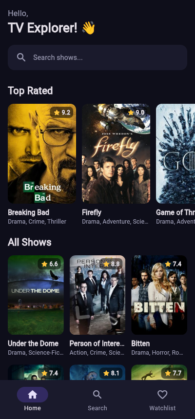
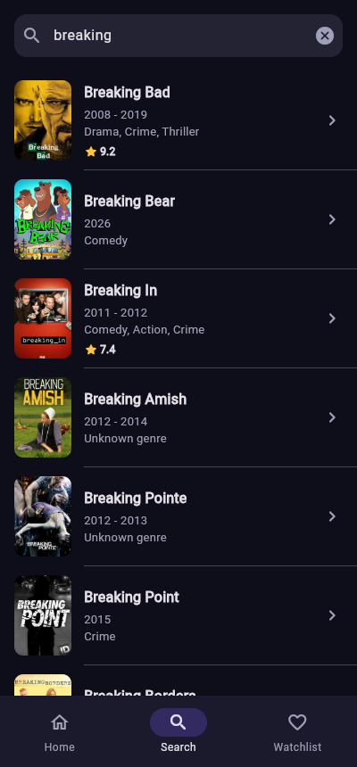
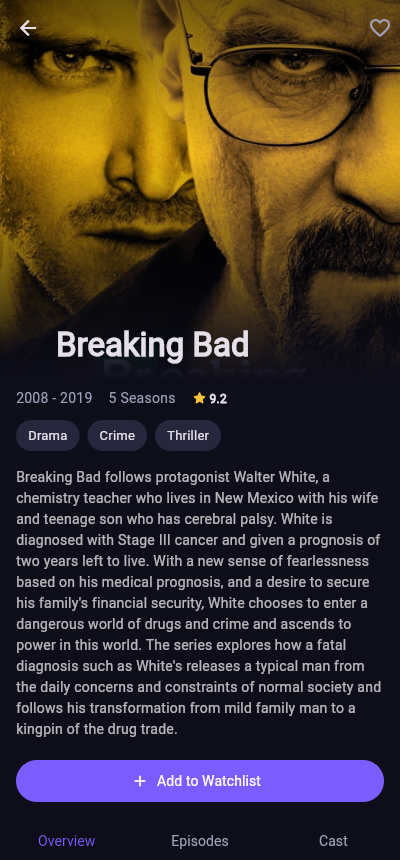
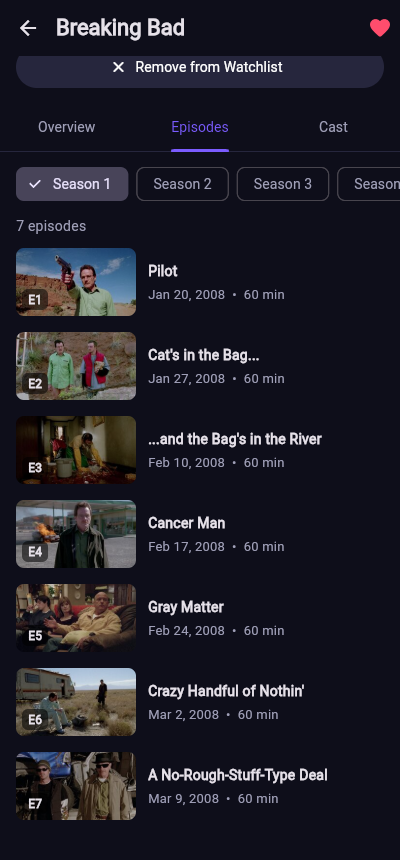
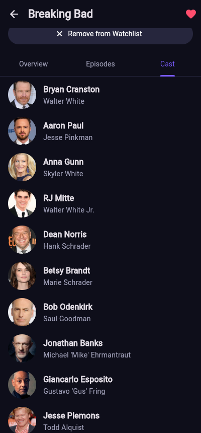
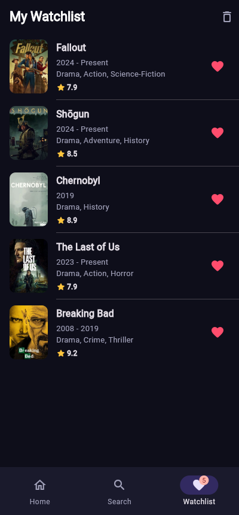
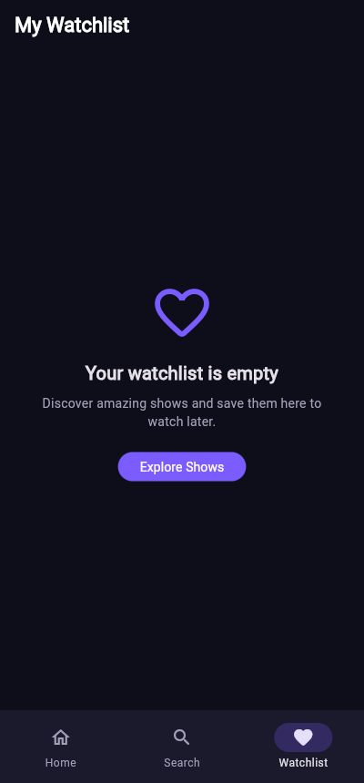
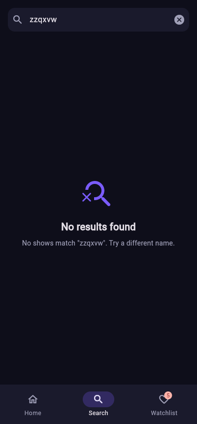
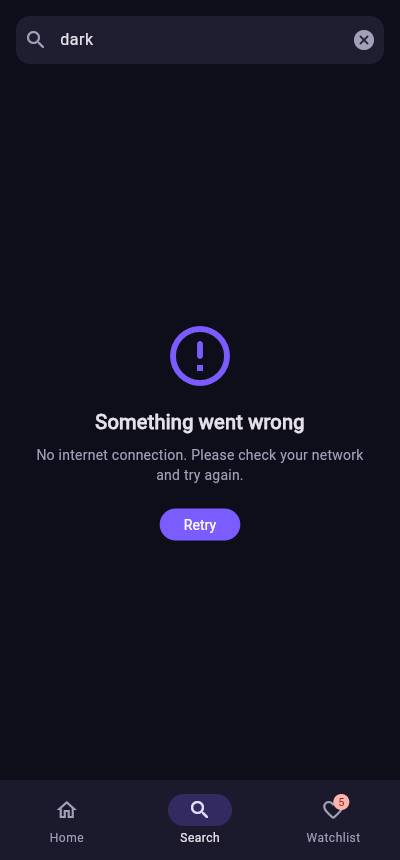

# TVMaze – TV Show Discovery App

A Flutter app for discovering TV shows, built with the **BLoC** state management pattern and the free [TVMaze API](https://www.tvmaze.com/api).

Browse shows with infinite scrolling, search by name, open a show to see its summary, cast and episodes by season, and keep a personal watchlist that is saved on the device.

## Screenshots

| Home | Search | Show details |
|:---:|:---:|:---:|
|  |  |  |

| Episodes by season | Cast | Watchlist |
|:---:|:---:|:---:|
|  |  |  |

| Empty watchlist | No search results | No internet |
|:---:|:---:|:---:|
|  |  |  |

## Features

**Show listing**
- Fetches shows from the API and shows each one's poster, title, genres and rating
- Pagination: the next page loads automatically when you scroll near the bottom
- "Top Rated" row with the highest rated shows loaded so far
- Loading spinner on first load and at the bottom while the next page loads

**Search**
- Search shows by name, with results fetched live from the API
- Debounced: the API is only called once you stop typing for 500 ms
- Separate messages for "start typing", "no results found" and errors

**Show details**
- Poster, title, years, number of seasons, rating, genres and summary
- **Overview** tab: status, network, premiere date, schedule, runtime, language
- **Episodes** tab: episodes grouped by season, with a season picker
- **Cast** tab: actors and the characters they play
- Add to / remove from watchlist

**Watchlist**
- Add and remove shows from the details screen, or with the heart on the watchlist screen
- Saved locally with `shared_preferences`, so it is still there after restarting the app
- Badge on the tab with the number of saved shows, "clear all" with confirmation, and an empty state

**Error handling**
- No internet, timeouts, rate limiting (HTTP 429), server errors and invalid responses all show a readable message with a **Retry** button
- Missing data (no poster, rating, summary, network, etc.) shows a placeholder or "N/A" instead of crashing

## Getting started

### Requirements
- [Flutter SDK](https://docs.flutter.dev/get-started/install) (stable channel, 3.32 or newer; tested with 3.47)
- One of: Chrome (easiest), an Android emulator/phone, or an iOS simulator

### Run the app

```bash
git clone <your-repo-url>
cd tvmaze_app
flutter pub get
flutter run
```

`flutter run` asks which device to use. To run it in Chrome directly:

```bash
flutter run -d chrome
```

### Run the tests

```bash
flutter test
```

### VS Code
1. Install the **Flutter** extension (it also installs the Dart extension).
2. Open the `tvmaze_app` folder.
3. Pick a device in the bottom-right corner of the status bar and press **F5**.

## Architecture

The app is split into layers. Each layer only talks to the one below it, so **no widget ever calls the API directly**.

```
 UI (screens & widgets)      shows states, sends events
        │  ▲
 events │  │ states
        ▼  │
 BLoC                        business logic: pagination, debounce, grouping, watchlist rules
        │
        ▼
 Repositories                ShowRepository: JSON -> models
        │                    WatchlistRepository: saves to SharedPreferences
        ▼
 ApiClient                   HTTP + error handling
        │
        ▼
 TVMaze API (https://api.tvmaze.com)
```

### Folder structure

```
lib/
├── main.dart                         # Creates the repositories and starts the app
├── app.dart                          # Provides the repository and app-wide BLoCs
├── core/
│   ├── network/api_client.dart       # HTTP GET + ApiException
│   ├── theme/app_theme.dart          # Colors and dark theme
│   └── utils/text_utils.dart         # Removes HTML from summaries
├── data/
│   ├── models/                       # Show, CastMember, Episode (fromJson / toJson)
│   └── repositories/                 # ShowRepository, WatchlistRepository
├── bloc/
│   ├── shows/                        # Home list + pagination
│   ├── search/                       # Debounced search
│   ├── show_details/                 # Details + cast + episodes
│   └── watchlist/                    # Saved shows
└── ui/
    ├── screens/                      # MainShell, Home, Search, ShowDetails, Watchlist
    └── widgets/                      # Reusable: ShowPoster, ShowCard, ShowListTile,
                                      # RatingBadge, MessageView, WatchlistIconButton
test/                                 # Unit tests for the models and every BLoC
```

Each BLoC has three files: `*_bloc.dart` (logic), `*_event.dart` (what can happen) and `*_state.dart` (what the UI can show).

### The BLoCs

| BLoC | Events | States | Notes |
|---|---|---|---|
| `ShowsBloc` | `ShowsFetched` | `ShowsState` with `status`: `initial` / `loading` / `success` / `failure`, plus `shows`, `nextPage`, `hasReachedMax` | One state class, because the list must keep the shows it already has while the next page loads or fails. `droppable()` ignores repeated fetches while a page is loading. |
| `SearchBloc` | `SearchQueryChanged` | `SearchInitial`, `SearchLoading`, `SearchSuccess`, `SearchEmpty`, `SearchFailure` | Sealed classes: the UI uses a `switch`, and the compiler checks every state is handled. Debounce (500 ms) + `switchMap` cancels outdated searches. |
| `ShowDetailsBloc` | `ShowDetailsRequested` | `ShowDetailsLoading`, `ShowDetailsLoaded`, `ShowDetailsFailure` | Loads details, cast and episodes **in parallel** with `Future.wait`, and groups episodes by season. A new instance is created for each details screen. |
| `WatchlistBloc` | `WatchlistStarted`, `WatchlistShowToggled`, `WatchlistCleared` | `WatchlistState` with `shows`, `isLoading`, `errorMessage` | Shared by the whole app. Updates the UI right away, then saves; restores the old list if saving fails. `sequential()` handles one change at a time. |

How a screen uses a BLoC:
- **`BlocProvider`** creates a BLoC and makes it available to the widgets below it.
- **`BlocBuilder`** rebuilds part of the screen when the state changes.
- **`BlocSelector`** rebuilds only when one value changes (e.g. "is this show saved?").
- **`BlocListener`** runs one-off actions, like showing a SnackBar when saving fails.
- **`context.read<Bloc>().add(Event())`** sends an event.

### API endpoints

| Feature | Endpoint |
|---|---|
| Shows (paginated) | `GET /shows?page={n}` |
| Search | `GET /search/shows?q={query}` |
| Show details | `GET /shows/{id}` |
| Cast | `GET /shows/{id}/cast` |
| Episodes | `GET /shows/{id}/episodes` |

`/shows` returns up to 250 shows per page and answers **404** after the last page. The repository turns that 404 into an empty list, which the BLoC reads as "no more pages".

### Packages

| Package | Why |
|---|---|
| `flutter_bloc` | BLoC state management |
| `bloc_concurrency` | `droppable()` and `sequential()` event transformers |
| `stream_transform` | `debounce` and `switchMap` for search |
| `equatable` | Value equality for states and events, so BLoC can skip duplicate states |
| `http` | API requests |
| `shared_preferences` | Saves the watchlist on the device |
| `bloc_test`, `mocktail` | Testing BLoCs with a mocked repository (dev only) |

## Common questions (viva prep)

**Why BLoC?** It keeps business logic out of widgets. The UI only sends events and draws states, so the logic can be tested without any UI (see `test/`).

**How does pagination work?** `HomeScreen` listens to the scroll position. Within 600 px of the bottom it sends `ShowsFetched`. `ShowsBloc` loads `nextPage`, appends the shows to the list, and increases `nextPage`. An empty page sets `hasReachedMax`, and fetching stops.

**How does debounce work?** Every keystroke sends `SearchQueryChanged`. The event transformer `events.debounce(500ms).switchMap(mapper)` only lets an event through after 500 ms without typing. If a newer query arrives while a search is running, `switchMap` cancels the old one.

**How is the watchlist saved?** `WatchlistRepository` turns the list of shows into JSON (`Show.toJson`) and stores it under one SharedPreferences key. On start, `WatchlistStarted` reads it back with `Show.fromJson`.

**Why are the selected tab and season not in a BLoC?** They are temporary UI state that only one widget uses, so `setState` is enough. All data and business logic go through BLoCs.

**How are errors handled?** `ApiClient` turns every failure (no internet, timeout, HTTP errors, bad JSON) into an `ApiException` with a readable message. The BLoCs catch it and emit a failure state, and the UI shows the message with a Retry button.
